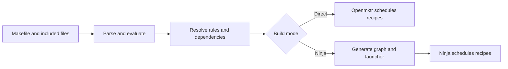

> FORK MODIFICATION NOTICE (2026)
> Added an opt-in Gentoo overlay, Portage adapter, and load-average limits.
> Added automatic Ninja build usage, locking, and generated-file safety guidance.
> Added conservative recursive no-op caching and shared Ninja recipe limits.
> Added optional compatibility lanes and phase/end-to-end benchmark guidance.
> Changed by the Openmktr fork, maintained by Rihards Paps and
> Haralds Paps. Rewritten and expanded the fork's overview, build instructions,
> usage examples, architecture, compatibility guidance, troubleshooting,
> and versioned release documentation.
> Upstream material retains its Apache-2.0 terms. Fork modifications are
> covered by Mozilla Public License 2.0; see docs/LICENSING.md and NOTICE
> at the repository root. Original notices below remain applicable.

# Openmktr

**Read Makefiles. Build targets in parallel. Generate Ninja graphs.**

Openmktr (Open Make Translator) is a C++17 fork of
[Google Kati](https://github.com/google/kati).
Its `omktr` executable parses and evaluates Makefiles, resolves dependencies,
and either runs recipes directly or writes a build graph for Ninja to execute.
Both workflows start with your existing Makefile.
Openmktr extends its Kati starting point with parallel recipe scheduling:
independent steps can run concurrently while dependencies preserve the
required order. Both direct execution and generated Ninja builds can use this
parallelism.

The supported platform is **Linux with musl or glibc**, using Clang/LLVM and libc++.
[Chimera Linux](https://chimera-linux.org/about/) is the reference build and
test environment. The source has also been built in Alpine's musl/BusyBox
environment and Gentoo linux. Openmktr does not depend on Chimera-specific utility interfaces;
equivalent POSIX tools, including BusyBox, Toybox, or BSD-derived
implementations, can provide the basic system commands. The full snapshot suite
remains tied to the reference environment. Optional manually dispatched
[compatibility lanes](validation/compatibility/README.md) exercise Alpine/musl
and Gentoo/glibc, including Ninja >= 1.13 jobserver behavior; their coverage
does not replace the reference gate.

| Capability | What you can do |
| --- | --- |
| Direct execution | Build requested Makefile targets with parallel recipe scheduling. |
| Ninja generation | Turn evaluated Makefile rules into a Ninja graph and generated launcher. |
| Regeneration checks | Reuse a generated graph when its recorded inputs remain current. |
| Recursive builds | Run child Openmktr builds with shared job limits. |
| Opt-in Portage integration | Use a local Gentoo overlay and select direct or experimental Ninja compilation per package. |
| GNU-free project toolchain | Build, test, and run Openmktr with LLVM, musl, libc++, Ninja, Python, and POSIX shell tools. |

Openmktr is an actively developed Makefile translator, with direct and Ninja
build modes, working toward broad compatibility across Makefile-driven
projects. It has completed verified builds across dozens of projects and
components, while support continues to grow and compatibility can depend on the
Makefile and build mode. See [compatibility and scope](#compatibility-and-scope)
and the [verified build results](validation/PROGRESS.md) for tested
configurations and current limits.

## Contents

- [Build Openmktr](#build-openmktr)
- [Try it in five steps](#try-it-in-five-steps)
- [Choose a build mode](#choose-a-build-mode)
- [Everyday usage](#everyday-usage)
- [How it works](#how-it-works)
- [Compatibility and scope](#compatibility-and-scope)
- [Validation and performance](#validation-and-performance)
- [Troubleshooting](#troubleshooting)
- [Contributing and documentation](#contributing-and-documentation)
- [Maintainers, credits, and licensing](#maintainers-credits-and-licensing)

## Build Openmktr

### Versioned releases

The release workflow publishes versioned source ZIPs, Linux x86_64 musl binary
archives, and SHA-256 checksums to
[GitHub Releases](https://github.com/RihardsPaps/Openmktr/releases).
Binary archives include licenses, notices, and a link to their corresponding
source. They require compatible musl and LLVM libc++ runtime libraries;
consult `README.txt` and `runtime-dependencies.txt` inside the archive.
Other platforms remain best effort.

Maintainers publish a release by pushing a `vMAJOR.MINOR.PATCH` tag, such as
`v0.1.0`, on a commit contained in the repository's default branch (currently
`main`). Its `.github/workflows/` files must match the default branch tip;
the workflow rejects other targets before building because the Actions token
cannot publish releases with differing workflow files. The
[release workflow](.github/workflows/release.yml) builds in the pinned Chimera
image and runs the standard suites, sanitizer checks, and packaging checks
before publishing. All assets are uploaded to a draft before it becomes
public. A failed upload leaves a draft that the same tag run can retry;
published assets are never replaced. Pull requests affecting release tooling
and manual workflow runs validate and retain artifacts without publishing.

### Build requirements

Openmktr's own build needs Clang/LLVM with LLD, libc++, Ninja, Python 3, a
POSIX shell, and basic system utilities. Package names vary by distribution;
no Chimera-specific utility package or GNU userland is required.

On Chimera Linux, install the toolchain packages and build from the repository
root:

```sh
apk add clang ninja python
ninja -f build.ninja -j4 omktr
./omktr --version
```

Installing packages requires the appropriate system privileges. The executable
is written to `./omktr`; intermediate build files go into `out/`.

On other systems, install equivalent LLVM, libc++, Ninja, and Python packages
using that system's package manager. Existing POSIX-compatible system
utilities are sufficient; the `chimerautils` package is not a project
dependency.

The checked-in [build graph](build.ninja) uses C++17, Clang++, libc++, LLVM's
lld linker, and ThinLTO. Ninja's `deps = gcc` setting names a compiler depfile
format; it does not invoke GCC.

### Build and test in a container

With Docker available, run these commands from the repository root:

```sh
docker build -t openmktr-test .
docker run --rm openmktr-test
```

The [Dockerfile](Dockerfile) uses a pinned Chimera toolchain, builds `omktr` and the
C++ test binaries, checks for unwanted GNU dependencies, and runs the standard
suites when the container starts. Unit, version, correctness, compatibility,
and include-dump checks have also passed in Alpine with its BusyBox utilities.
The executable stays inside the image; this workflow does not install it on
the host.

Docker and the CI host are external infrastructure. The CI image runs in
Chimera; the independent Alpine run also built the source and passed the core
checks listed above.

## Try it in five steps

After building `omktr`, start in the repository root and run the five steps
below in the same POSIX shell. The example creates a disposable workspace so
conversion cannot replace the repository's own build graph.

**1. Save the executable path and enter a temporary directory.**

```sh
omktr_binary="$(pwd)/omktr"
demo_dir="$(mktemp -d)"
cd "$demo_dir"
```

**2. Create a small Makefile.** The recipe line begins with a literal tab.

```sh
cat > Makefile <<'EOF'
.PHONY: all
all: hello.txt

hello.txt:
	printf 'hello from omktr\n' > $@
EOF
```

**3. Build the target directly.**

```sh
"$omktr_binary" -f Makefile -j4 all
cat hello.txt
```

The file contains `hello from omktr`.

**4. Remove the result and build it through Ninja.**

```sh
rm hello.txt
"$omktr_binary" build -j4 -f Makefile all
cat hello.txt
```

You get the same file through the generated graph.

**5. Run the build command again.**

```sh
"$omktr_binary" build -j4 -f Makefile all
```

Ninja should report that there is no work to do. The demo remains in
`$demo_dir` for inspection.

> **Legacy `--ninja` conversion writes `build.ninja` by default.** Run conversion examples in a
> disposable directory. Running them at this repository's root can overwrite
> the checked-in graph used to build Openmktr itself.

## Choose a build mode

| Behavior | Direct execution | Generated Ninja |
| --- | --- | --- |
| Invocation | `omktr -f Makefile -j4 all` | `omktr build -j4 -f Makefile all` (or the legacy two-step interface) |
| Makefile evaluation | Reads and evaluates Makefiles on each invocation. | Evaluates Makefiles when generating the graph. |
| Recipe scheduling | Openmktr schedules work under its job limit. | Ninja schedules the generated edges. |
| Exported variables | Captured at recipe boundaries. | Recorded during generation and restored by generated recipes. |
| Recursive builds | Child Openmktr processes read their own Makefiles. | Recursive commands remain recipes; child graphs are not flattened into the parent graph. |
| Input changes | Handled on the next Openmktr invocation. | Checked automatically by `omktr build`; legacy launchers need an explicit regeneration check. |

Use direct execution to start evaluating an existing project, especially when
its dependencies can change while recipes run. Use Ninja generation when the
evaluated dependency graph suits your workflow and you want Ninja to schedule
subsequent builds.

### Keep a generated graph current

For everyday Ninja builds, use one command:

```sh
omktr build -j8 -f Makefile all MODE=release
```

Every invocation checks the existing regeneration stamp before launching Ninja.
Makefiles, includes, recorded environment inputs, wildcard results, shell
results, and generation arguments retain the existing invalidation checks.
The stamp persists generation arguments and relevant environment values;
repeat the desired targets and variable assignments on each invocation.
Changing `MODE=release` to `MODE=debug`, for example, regenerates the graph.
Standard-input Makefiles always regenerate. A failed generation stops the build.

This mode writes its graph, environment script, launcher, and stamp into
`.openmktr/` by default. `--ninja_dir DIR` overrides that directory; recipes
still run in the build working directory. Existing unrelated graphs at the
selected output path are refused. `-jN` controls Ninja and recursive job limits;
`-n` requests a dry run and `-k` continues independent work after failures.
Question, touch, syntax-only, empty-graph, and stamp-dump modes are rejected.

Concurrent `omktr build` commands in the same build working directory wait on
`.openmktr.lock`, held from input validation through Ninja completion. The lock
is released automatically when the supervisor exits; leave its file in place.
Generation runs with the current invocation's environment before the launcher
loads the recorded recipe environment. The generated launcher remains an
execution-only tool; use `omktr build` for automatic validation. Avoid mixing
concurrent legacy generation or standalone Ninja invocations with this mode.

Advanced users can keep generation and execution as two separate steps. Before
a Ninja build, rerun the same generation command, including its targets and
variable assignments:

```sh
omktr --ninja --regen -j8 -f Makefile all MODE=release
sh ./ninja.sh -j2
```

`--regen` checks recorded inputs and command results, reusing the graph when
they are current. Standard-input Makefiles always regenerate. Ninja itself
does not re-evaluate Makefiles.

Use the generated `ninja.sh` launcher to load the recorded environment and
coordinate job limits with recursive Openmktr builds. Set runtime concurrency on
that launcher; its `-j` value is independent of the generation-time `-j` value.
For example, you can generate with `-j8` and build with `-j2`, or use a higher
Ninja job count than the one used for generation. Run the launcher from the same
working directory used for generation.

## Everyday usage

Gentoo users can install the live ebuild and opt selected packages into their
normal Portage lifecycle using the [local overlay and adapter](packaging/gentoo/README.md).
Direct execution is the default; experimental Ninja compilation is available
per package. Installing the tool does not activate any package automatically.

These examples assume `omktr` is on your `PATH` and you are in the project you
want to build. Otherwise, use the executable's absolute path.

```sh
# Build a named target with four jobs.
omktr -f Makefile -j4 all

# Validate or regenerate a Ninja graph and build in one command.
omktr build -j8 all MODE=release

# Supply a command-line variable assignment.
omktr -f Makefile -j4 all MODE=release

# Build in a different working directory.
omktr -C path/to/project -f Makefile -j4 all

# Inspect the recipes for a direct build.
omktr -n -f Makefile all

# Generate files in a separate directory, then run the launcher.
omktr --ninja --regen --ninja_dir .kati -f Makefile all
sh ./.kati/ninja.sh -j4
```

`--ninja_dir` changes where generated files are written. It does not change
the working directory for the build's recipes.

### Common options

| Option | Purpose |
| --- | --- |
| `-f FILE` | Read a Makefile; `-f -` reads standard input. |
| `-C DIR` | Change the working directory before processing the build. |
| `-jN` | Set direct execution concurrency. For Ninja builds, pass `-jN` to the launcher. |
| `-lN` | Delay additional recipes while load average is at least N; one recipe can always progress. Zero serializes; bare `-l` clears the limit. |
| `-k` | Continue independent work after recipe failures. |
| `-n` | Print ordinary recipes without executing them. Recursive Make commands and recipes marked `+` can still run. |
| `-q` | Check whether targets need building. |
| `-t` | Update target timestamps instead of running ordinary recipes. |
| `--ninja` | Generate a Ninja graph, environment script, and launcher. |
| `build` | First argument: validate or generate a graph in `.openmktr/`, then run Ninja. |
| `--regen` | Check recorded inputs before reusing a generated graph. |
| `--recursive_cache` | Cache validated no-op decisions for eligible recursive children. |
| `--regen_debug` | Enable diagnostics for regeneration checks. |
| `--explain TARGET` | Explain resolved rules and Make freshness without running recipes. |
| `--strict-compat` | Reject known constructs whose behavior cannot be preserved in the selected mode. |
| `--ninja_dir DIR` | Write generated files into the specified directory. |
| `--version` | Print a Make compatibility banner and the Openmktr source revision. |

### Identify the binary

Git builds include the source revision and a `+dirty` suffix when the checkout
has uncommitted changes. `OMKTR_SOURCE_REVISION` can supply an explicit build
revision; source archives without Git metadata or an explicit revision report
`unversioned`.

The `GNU Make 4.2.1` line in `--version` is a compatibility banner. The following
`omktr` line identifies the Openmktr build; the banner does not establish complete
GNU Make compatibility.

## How it works

Both modes share the same parser, evaluator, and dependency resolver. The
execution path branches after Openmktr has interpreted the Makefile's rules.



| Stage | Main implementation |
| --- | --- |
| Parse statements and expressions | [parser.cc](src/parser.cc), [expr.cc](src/expr.cc) |
| Cache parsed includes | [file_cache.cc](src/file_cache.cc) |
| Evaluate variables, directives, functions, and rules | [eval.cc](src/eval.cc), [stmt.cc](src/stmt.cc), [func.cc](src/func.cc) |
| Resolve rules and dependencies | [dep.cc](src/dep.cc) |
| Expand recipes and execute direct builds | [command.cc](src/command.cc), [exec.cc](src/exec.cc) |
| Generate Ninja files and check regeneration | [ninja.cc](src/ninja.cc), [regen.cc](src/regen.cc) |

Recursive recipes using `$(MAKE)` invoke Openmktr through its executable path.
Child builds evaluate their own Makefiles at execution time. In Ninja mode,
the generated launcher supplies the shared Openmktr jobserver for those children.

For repeated recursive builds, opt into conservative child no-op caching:

```sh
omktr build --recursive_cache -j32 all
```

The option also works with direct execution and propagates to child Openmktr
processes. Eligible unchanged children reuse a validated no-op certificate in
`.openmktr-recursive-cache`, avoiding parsing and evaluation. Changed inputs,
missing outputs, dynamic evaluation, generated includes, unsupported graph
features, or invalid cache data fall back to normal evaluation and execution.
This first version caches no-op decisions; builds that need recipes use the
existing direct scheduler. It does not flatten child graphs. See the
[cache design and measurements](docs/recursive-cache.md) for eligibility and costs.

Ordinary generated Ninja recipes now acquire the shared FIFO budget, including
recipes in nested Ninja builds. A child Ninja borrowing one inherited reservation
runs serially to prevent separate helper processes from claiming that slot twice.

## Compatibility and scope

Compiler depfile inference remains disabled by default. Prefer explicit,
target-specific metadata when generating Ninja graphs:

```make
out.o: .KATI_DEPFILE = out.d
out.o: source.c
	clang -c -MMD -MF out.d -o $@ $<
```

`.KATI_DEPFILE` takes precedence over `--detect_depfiles`. The opt-in detector
accepts only a single literal invocation of `clang`, `clang++`, `cc`, `c++`,
`gcc`, or `g++`, optionally behind `ccache` or `sccache`, with `-c`, `-MD` or
`-MMD`, and an explicit `-o` output. It preserves the compiler's depfile and
gives Ninja a temporary copy. Quoting, shell expansions, compound commands,
redirections, response files, unknown compiler options, and unknown wrappers
are deliberately declined;
this also replaces the inherited Android command-rewriting special cases.
Use explicit metadata for those recipes and for unusual filenames. Declined
inference adds no dependency tracking, so ensure the Makefile prerequisites
or explicit depfile describe every required input.

### Makefile support

Openmktr supports a subset of GNU Make syntax and behavior. The dynamic-extension
`load` directive is unsupported, and BSD Make dialect support is incomplete.
Some dynamic Makefile features have no exact Ninja equivalent.

Pay particular attention to parse-time `$(shell ...)` expressions when
converting a build: evaluation and regeneration checks can run shell commands
before Ninja executes any recipes. Check their side effects and verify both
the first build and subsequent incremental builds.

### The GNU-free boundary

The project-controlled build, tests, and runtime use Clang/LLVM, musl, libc++,
Ninja, Python, and POSIX shell tools. They do not require GNU Make, GCC, glibc,
Bash, or GNU utilities. Openmktr implements Makefile compatibility itself.

Commands in user-supplied recipes and `$(shell ...)` expressions can invoke
other tools. Those commands are outside this guarantee, as are external
campaign infrastructure and third-party build requirements. Converting a
Makefile does not replace the tools that its recipes call.

### Recorded compatibility evidence

See the [campaign results](validation/PROGRESS.md) for verified builds of
selected, pinned releases and configurations, together with skips, unresolved
gaps, and coverage limits. The matrix records the results for those specific
runs; it does not establish compatibility for every version or target.

All build configurations currently marked PASS in the campaign matrix have
been verified to build successfully. The most recent end-to-end check built
FFmpeg 9.0.2 through Ninja, completing all 2,677 steps; the resulting
executable passed a short audio/video encode and decode smoke check.

Read the [campaign guide](validation/README.md) before using its tools or
citing a result. The helpers target a specific recorded environment and do
not replace the portable CI checks.

## Validation and performance

The portable pull-request gate is defined in
[cpp-ci.yml](.github/workflows/cpp-ci.yml). It builds and tests the Chimera
image, checks changed C++ formatting, and runs a separate sanitizer build.

Inside Chimera, run the standard checks with:

```sh
ninja -f build.ninja -j4 omktr tests
out/find_test && out/ninja_test && out/strutil_test && out/load_limit_test
python tests/version_generator.py
python tests/correctness.py
python tests/make_compat_regressions.py
python tests/portage.py
python tests/load_limits.py
python tests/portage_validation.py
python tests/regression.py
sh testcase/dump/run.sh
```

The suites cover C++ helpers, revision generation, incremental builds,
failures, exports, regeneration, dependency and variable semantics, recursive
builds, and parallel execution. They use self-contained expectations and
checked-in snapshots, without requiring a GNU Make reference executable.
Some fixtures intentionally expect a nonzero exit status.

For a focused snapshot run:

```sh
python tests/regression.py --case automake_stdin_recursive
```

To measure conversion, regeneration, direct execution, peak memory, and binary
size, build baseline and candidate binaries with the same toolchain and run:

```sh
python tests/bench.py ./omktr
python tests/bench.py ./omktr --baseline /path/to/baseline/omktr
```

See [CONTRIBUTING.md](CONTRIBUTING.md) for formatting checks, snapshot updates,
sanitizer commands, and benchmark guidance.

## Troubleshooting

Use `omktr --explain target` to inspect the selected rule's Makefile and line,
recipe location, resolved normal and order-only prerequisites, expanded recipe,
and freshness decision. The report includes visited prerequisites and identifies
missing outputs, phony targets, newer prerequisites, planned prerequisite
updates, independent double-colon groups, and recursive directory recipes.
Recursive calls are labeled as child builds evaluated at runtime; their graphs
are not flattened into the parent graph.

For conversion diagnostics, repeat the generation command with `--explain`, for
example `omktr --ninja --regen --explain all`. This also checks recorded
regeneration inputs, reports the decision and its cause, and leaves the graph,
launcher, environment script, and regeneration stamp unchanged. Recipe expansion
uses Ninja's deferred shell expressions in this mode. Freshness describes Make
semantics at the time of inspection; Ninja can additionally rebuild for command
changes, dependency logs, or missing depfiles. Use `sh ninja.sh -d explain target`
to inspect those scheduler decisions in an already generated graph.

Explanation runs no recipes, including recursive and `+` recipes. Evaluating
Makefiles and expanding recipes can still run Make functions such as `$(shell)`
or `$(file)`; regeneration checks can also repeat recorded evaluations. If a
generated Makefile needs rebuilding, explanation stops with a diagnostic: run a
normal build first so the report can use its resulting rules. `--explain`
cannot be combined with `build`, `-n`, `-q`, or `-t`.

Enable `--strict-compat` to turn known compatibility gaps into source-located
errors. It currently rejects `.NOTINTERMEDIATE` in both modes, and rejects
intermediate-file lifetime differences and recipe-time `$(eval)` in Ninja mode.
Use direct execution for those Ninja limitations, or mark deliberately retained
intermediates with `.SECONDARY`. Parse-time `$(eval)` and recursive builds remain
supported. Strict mode propagates to recursive Openmktr calls. This is an
incremental set of checks, not a proof of complete Make compatibility; opaque
shell recipes and external tool behavior remain outside its coverage.

| Symptom | What to check |
| --- | --- |
| The native build cannot find libc++ or lld. | Use the supported Chimera packages or the container workflow. Other platforms are best effort. |
| Ninja uses an old rule or variable value. | Use `omktr build` with the desired targets and variable assignments, or rerun legacy generation with `--regen` before invoking its launcher. |
| Recursive Ninja builds have unexpected environment or concurrency behavior. | Use the generated `ninja.sh` launcher and set its runtime `-j` limit. |
| A recursive edge fails without an obvious cause. | Inspect the child command's output and exit status; the parent edge names the failed recipe. See the [recursive-build diagnosis guide](validation/README.md#diagnose-recursive-ninja-failures). |
| Shell commands run during conversion. | Check parse-time `$(shell ...)` expressions and regeneration checks. |
| A Makefile fails on BSD directives or `load`. | Check the syntax limits above; changing the scheduler does not add support for those constructs. |
| A project still invokes GNU tools after conversion. | Inspect its recipes and shell expressions. Those commands retain their external tool requirements. |

## Contributing and documentation

Open issues and pull requests in the
[project repository](https://github.com/RihardsPaps/Openmktr).
For a useful bug report, include a minimal Makefile, the command, `omktr --version` output, platform, expected result, and actual output. For Ninja
issues, include both the generation command and the launcher command.

For code changes, keep fixes focused and add a regression test. Changes to
shared semantics need coverage in both direct and Ninja modes. Preserve the
GNU-free toolchain and all applicable copyright and license notices.

| Guide | What you will find |
| --- | --- |
| [Contributing](CONTRIBUTING.md) | Validation commands, fixtures, formatting, sanitizers, benchmarks, and source layout. |
| [Compatibility validation](validation/README.md) | Campaign workflow, evidence requirements, and recursive-build diagnosis. |
| [Campaign results](validation/PROGRESS.md) | Recorded configurations, outcomes, and known limits. |
| [Licensing and provenance](docs/LICENSING.md) | License scope, attribution, contributions, and redistribution requirements. |
| [Agent guidance](AGENTS.md) | Repository rules and the GitHub issue workflow for automated agents. |

## Maintainers, credits, and licensing

[Rihards Paps](https://github.com/RihardsPaps) designed the GNU-free direction.
Rihards and [Haralds Paps](https://github.com/HarryMidnight) jointly own the
repository and maintain the fork.

This project derives from [Google Kati](https://github.com/google/kati). The
original upstream [author record](LICENSES/upstream-AUTHORS.txt) and
[contributor record](LICENSES/upstream-CONTRIBUTORS.txt) are preserved alongside
existing source notices.

The fork is licensed under the **[Mozilla Public License 2.0 (MPL 2.0)](LICENSE)**.
Original upstream material retains its [Apache License 2.0](LICENSES/Apache-2.0.txt)
terms and existing rights. See
[licensing and provenance](docs/LICENSING.md) and [NOTICE](NOTICE) for the scope
of each license and the notices required for redistribution.

Original fork contributions use Mozilla Public License 2.0 unless different
terms are explicitly identified and accepted. Preserve upstream notices and
identify changes to upstream-derived files as described in the licensing guide.

An **Apache License 2.0 option is available by negotiation**. Interested parties
can email [rihardspaps6@gmail.com](mailto:rihardspaps6@gmail.com). The Apache
option for fork contributions requires a separate agreement; it is not an
automatic alternative to MPL 2.0.
