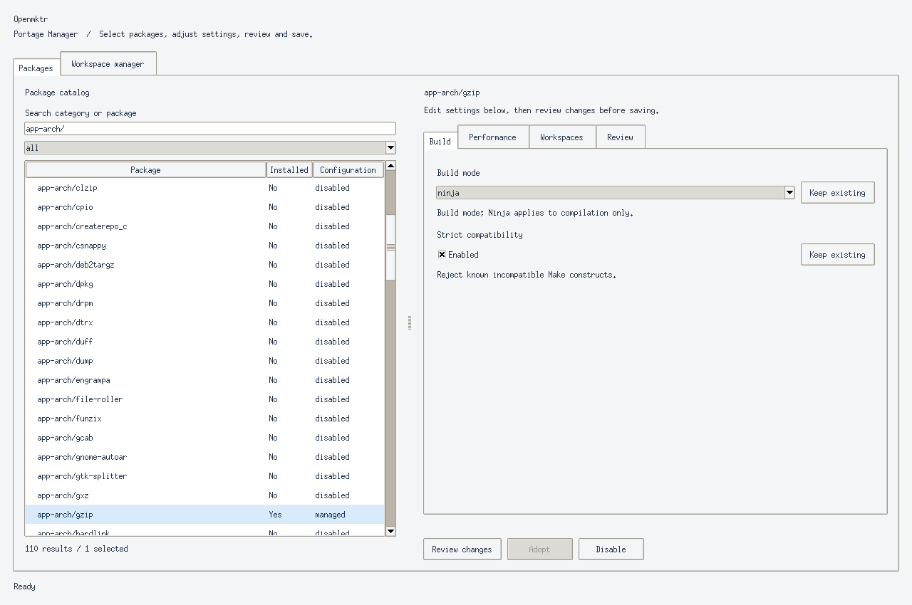
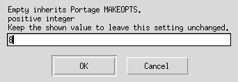
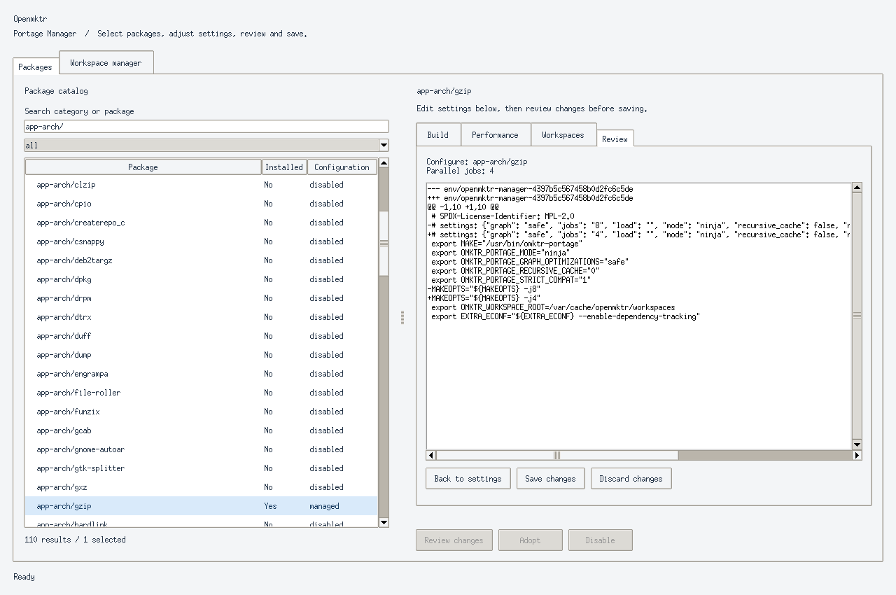
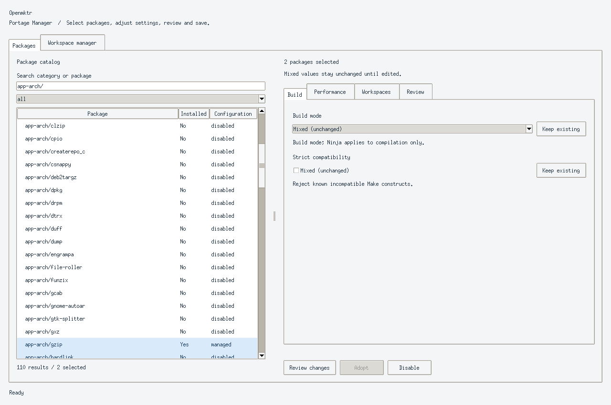
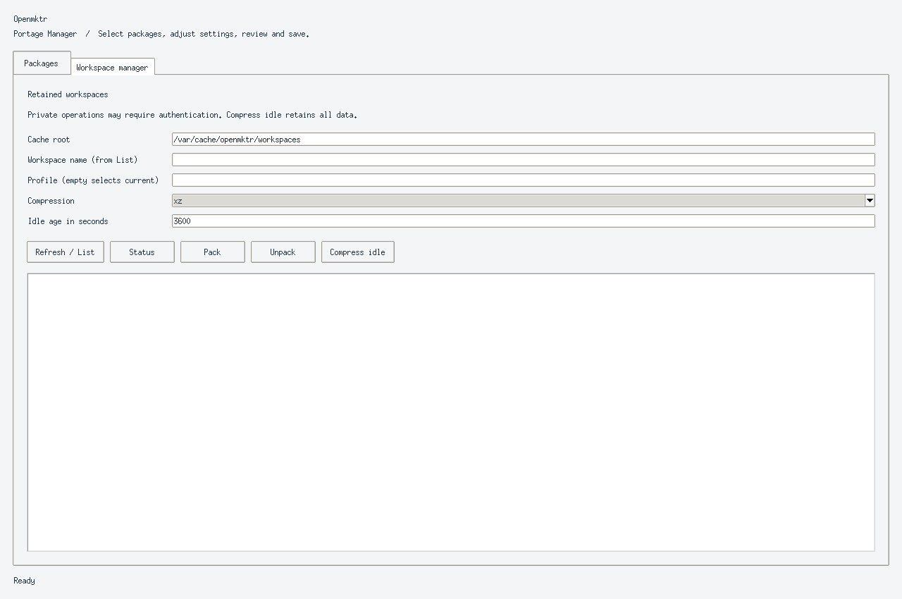

# Opt-in Gentoo Portage integration

This experimental integration targets native Linux Gentoo, EAPI 8, without
Gentoo Prefix. Installation alone activates no packages. It does not establish
compatibility with every ebuild or Makefile. The live ebuild builds the current
`main` source using LLVM, libc++, Ninja, and Python; Portage's own Bash and system
tools belong to this optional external environment, not the portable core.

## Install from a local overlay

Obtain a checkout containing this integration, then register its **absolute**
`packaging/gentoo` directory in `/etc/portage/repos.conf/openmktr.conf`:

```ini
[openmktr]
location = /absolute/path/to/Openmktr/packaging/gentoo
masters = gentoo
auto-sync = no
```

Keep that checkout at a stable, Portage-readable location. It supplies the
overlay metadata; the live ebuild independently fetches upstream `main`.
An unpublished local development branch must be tested using the validation
lane's local Git source override, rather than assuming `main` contains it.

Explicitly accept the live package in `/etc/portage/package.accept_keywords`:

```text
=dev-build/openmktr-9999::openmktr **
```

Portage accepts either a file or a directory at `package.accept_keywords`,
`package.env`, and `package.use`. If your configuration uses directories, put
the corresponding lines in a new `openmktr` file inside each directory. If it
uses files, append the lines to those files. Preserve existing configuration;
do not replace a file with a directory or overwrite its contents.

Then run `emerge --ask dev-build/openmktr::openmktr`. The ebuild installs
`/usr/bin/omktr`, `/usr/bin/omktr-portage`, and the workspace helper together.
It declares LLVM/libc++ build requirements and Python/Ninja runtime dependencies. It honors
`CPPFLAGS`, `CXXFLAGS`, and `LDFLAGS` while selecting C++17, libc++, and LLD.
The Gentoo build invokes `/usr/bin/ninja-reference` explicitly at runtime and
requires Ninja 1.13.2 or newer. Your system's `ninja` alternative may remain Samurai;
installing Openmktr does not change that alternative. The portable source build
continues to use `ninja` from `PATH` unless configured at build time with
`OMKTR_NINJA_EXECUTABLE`.
The current binary release archives require musl; this ebuild builds natively
on Gentoo rather than installing those archives on glibc.

To run Openmktr's own test suite during installation, add
`dev-build/openmktr test` to `package.use` (or its `openmktr` snippet), and enable
Portage's `test` feature. This is separate from selecting Openmktr to build
another package. For per-package testing, create `/etc/portage/env/openmktr-test`
with `FEATURES="${FEATURES} test"`, then add
`dev-build/openmktr openmktr-test` to `package.env`.

Configuration examples are installed as documentation under
`/usr/share/doc/openmktr-9999/portage/examples/`. Portage may compress them;
read or decompress the example contents before copying them into configuration.
No example is activated automatically.

## Select individual packages

Create `/etc/portage/env/openmktr-direct` containing:

```sh
export MAKE="/usr/bin/omktr-portage"
export OMKTR_PORTAGE_MODE="direct"
```

Add a specific package to `/etc/portage/package.env`, for example:

```text
category/package openmktr-direct
```

Replace the placeholder with a package you intend to test. Build it using the
normal `emerge` command. Portage continues to own unpacking, configuration,
testing, staged installation into `${D}`, merging, and removal. Its `emake`
helper selects the wrapper through `MAKE` and supplies `MAKEOPTS` and
`EXTRA_EMAKE` once. Options such as `MAKEOPTS="-j4 -l2.5"` remain effective;
explicit ebuild arguments such as `-j1` retain their normal precedence.

For experimental Ninja compilation, copy that environment file to
`/etc/portage/env/openmktr-ninja`, change the exported mode to `ninja`, and
select it for the package instead. Only `src_compile` uses `omktr build`.
Configuration, test-target probes, tests, and installation use direct Openmktr.
When the phase is absent, direct execution is used. Recursive Make invocations
use the sibling `omktr` and its shared job budget. Ninja graphs, stamps, and
launchers stay in `.openmktr/` within the recipe working directory, with the
existing `.openmktr.lock` protecting concurrent invocations and regeneration.

The wrapper preserves argument boundaries and exports the sibling executable
as `MAKE`. A command-line `MAKE=...` assignment still takes precedence.
Use the installed absolute wrapper path in Portage configuration. Directory
symlinks are resolved to their physical directory; a symlink to the wrapper
file itself is not followed to locate its target's sibling executable. An alias
in another directory therefore needs `omktr` beside that alias.
Compiler settings, working directory, staged-install arguments, exit status,
and signals pass through. It does not replace the system `make` or intercept
hard-coded `make`, ebuilds that replace `MAKE`, or Meson/CMake Ninja builds.
Unsupported options fail visibly; there is no automatic GNU Make retry.
Ninja mode retains `omktr build`'s restrictions, including question and touch
modes during compilation. Use the direct environment for such packages.

## Persistent version-independent workspaces

Merge the installed `openmktr-workspace.bashrc` snippet into
`/etc/portage/bashrc`. It loads the workspace phase hooks only for packages
selected by the environment below. `package.env` itself accepts variable
settings rather than shell functions.

For qualified Make-based packages, the additional `openmktr-workspace` example
retains prepared sources, objects and Ninja state across Portage versioned work
directories. Create `/var/cache/openmktr/workspaces` owned and writable by the
`portage` build user, copy the installed environment example into
`/etc/portage/env/`, and select it per package with `package.env`. Merge its phase
hooks with any existing custom hooks. Installation never activates this profile.

The profile uses native EAPI 8 `S`/`B` layouts, Ninja compilation and enabled
Automake dependency tracking. It preserves Portage's normal preparation,
configuration, test and staged-install phases. Compiler/configuration/dependency
changes select separate profiles. Ownership checks prevent overlapping versions
from silently replacing active sources. Known disabled Automake dependency
tracking is rejected; other Makefiles must provide complete prerequisites.
Projects with additional versioned build paths need separate qualification.

`omktr workspace gc --root /var/cache/openmktr/workspaces --idle-seconds 3600`
compresses idle profiles; `pack --name CATEGORY/PN:SLOT:CHOST --root ...` packs a
selected profile immediately. The next prepared build restores it before use.
See [workspace usage and compression](../../docs/workspaces.md) for standalone
commands, cache ownership, configuration isolation and recovery behavior.
Zstandard uses Python's module when installed and otherwise the distribution
`zstd` executable. `USE=test` installs `app-arch/zstd` to exercise that alternative
backend and its interoperability with Python archives. XZ remains the default.

## Load limits and troubleshooting

`-lN`, `-l N`, `--load-average=N`, and `--max-load=N` accept finite nonnegative
limits. A bare `-l`, `--load-average`, or `--max-load` clears an earlier limit.
Limits propagate through `MAKEFLAGS`; command-line options take precedence.
At high load, one recipe can always progress. Zero serializes execution,
including Ninja. Failed load sampling warns once and conservatively serializes
that executor while a limit is enabled. A load limit does not coordinate the number of
packages Portage builds concurrently; configure Portage's own `--jobs` separately.

If a selected package fails, retain the full Portage log and Openmktr revision,
report which mode was selected, remove its activation, and rebuild normally.
An unsupported Makefile is not evidence of a Gentoo package defect.

## Disable or remove

Remove the package's Openmktr entry from `package.env` to restore its normal
build tool. Remove unused environment examples when no packages refer to them.
After disabling all users, `emerge --ask --unmerge dev-build/openmktr` removes
the tool. Remove the overlay configuration and its live keyword entry if no
longer needed. User-created configuration is never installed or removed by
the Openmktr ebuild.

## Validation

Portable wrapper and load tests run in the GNU-free Chimera gate. The optional
Gentoo compatibility lane additionally builds this ebuild from the candidate
Git source and runs disposable EAPI 8 fixture packages through real Portage
configuration, compilation, default test probes, testing, installation,
merge, and unmerge. See `validation/compatibility/README.md` at the source root
for commands and the evidence boundary. Passing those fixtures does not qualify
arbitrary third-party packages, cross-compilation, or Prefix.

## Interactive and scripted manager

Install with the optional `tui`, `gui`, and `policykit` USE flags for curses,
Tkinter, and authentication on Save. Installation activates no packages.
`omktr-manager gui` and `omktr-manager tui` browse packages as the current user.
System changes authenticate through `pkexec`; the graphical process stays
unprivileged. Without polkit, preview changes and run the equivalent CLI as an
administrator. Private workspace inspection also authenticates.

```sh
omktr-manager packages --filter installed --search sys-libs --json
omktr-manager show category/package --json
omktr-manager configure category/package other/package --set mode=ninja --dry-run
omktr-manager configure category/package --set mode=ninja --set jobs=4
omktr-manager disable category/package
omktr-manager adopt category/package --dry-run
omktr-manager setup-workspaces --dry-run
omktr-manager setup-workspaces
omktr-manager configure category/package --set mode=ninja --set workspace=true
omktr-manager workspaces --workspace-action list
omktr-manager workspaces --workspace-action pack --name CATEGORY/PN:SLOT:CHOST --profile PROFILE --compression xz
```

Settings are `mode`, `jobs`, `load`, `graph`, `recursive_cache`, `strict`,
`workspace`, and `root`. Booleans use `true` or `false`; empty jobs/load inherit
Portage settings. Workspace roots must be below `/var/cache/openmktr/`.
Workspace mode enables Automake dependency tracking and requires Ninja compilation.
`gc` compresses idle workspaces (default 3600 seconds); it does not delete them.

The manager uses a marked `package.env` block or directory snippet and environment
files named `openmktr-manager-*`. It preserves other entries. Adoption recognizes
unmodified direct/Ninja environment examples; complex or conflicting settings
require manual resolution. Existing custom bashrc content requires manual hook
composition. Use previews before adoption or workspace setup. Configured activation
does not establish compatibility with an arbitrary package or ebuild.

Saves reject stale previews and leave an exact before/after transaction journal
if interrupted. `omktr-manager recover`, run as administrator, rolls back a partial
save only when the files still match the journal; manual edits stop recovery.
An interrupted cache setup may leave a prepared directory, which is safe to reuse.

The GUI keeps package browsing beside categorized Build, Performance, and
Workspaces settings. Dropdowns select build and graph modes; checkboxes control
boolean settings. Jobs and load can explicitly inherit Portage settings.
Mixed batch fields stay unchanged until edited; Keep existing restores each
package's original value. Review changes shows the affected packages and exact
file diff before Save changes requests authentication. Back to settings
invalidates the preview. Authentication failures retain pending changes.

The Workspace manager provides inline fields for workspace/profile selection,
compression and idle age. Refresh / List discovers retained workspace names;
Status, Pack, Unpack and Compress idle use the entered selectors. Compress idle
retains data. The TUI keeps its existing keyboard and text-input workflow.

### GUI screenshots

These captures show actual Tk widgets under Xvfb with Gentoo's live package
catalog and disposable configuration. No system package was activated or saved.
The review changes jobs from 8 to 4 while preserving the other package settings.
The workspace screen shows the form before running an operation.










### Responsive browsing and advanced settings

The manager loads Portage after opening its interface and snapshots package
configuration for browsing. Refresh catalog reloads external changes. Search
and Enter apply the query immediately; typing waits 200 ms. Clear restores the
catalog without discarding selected packages or edits. F11 toggles fullscreen;
Escape restores the window. Settings scroll in smaller windows.

Jobs inherit Portage MAKEOPTS unless explicitly changed. The GUI's Use available
CPUs button (or `cpus` at the TUI jobs prompt) stages an explicit job count.
Build jobs govern recipes, independently of interface discovery and rendering.
An inherited limit is resolved by Portage during a build, not inferred from the
manager's process environment. A zero load limit serializes recipes.

Advanced settings include `disabled_graph_optimizations` (comma-separated
`evaluation,includes,recursive,compact,monitor` exclusions), `build_stats`, and
`regen_debug`. Exclusions override the selected graph profile; statistics add
build log output, and regeneration explanations apply to Ninja regeneration.
At the TUI exclusions prompt, `none` clears all exclusions; Enter keeps them.
Boolean values use `true` or `false` with CLI `--set`. Defaults are no exclusions
and both diagnostics disabled. Existing generated files remain readable and are
upgraded only through a reviewed save.

For graphical checks, first build `openmktr-test`, then run
`docker build -f Dockerfile.frontend -t openmktr-frontend .` and
`docker run --rm openmktr-frontend`. This extends Chimera with Tk, Xvfb, and the
optional CPython Tk extension compiled with Clang. No host display is used.
